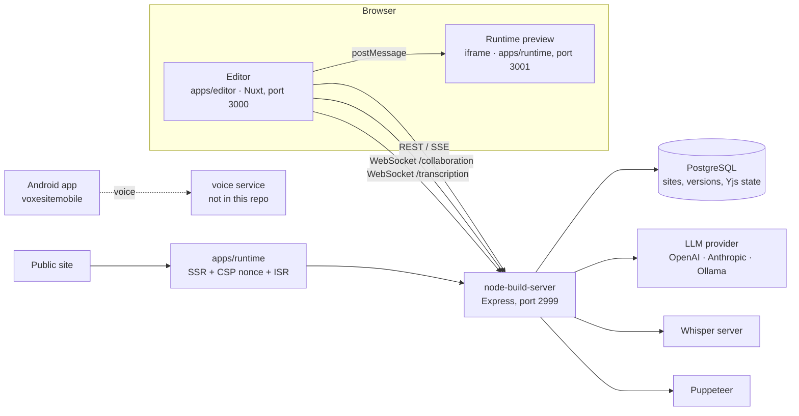

# voxesite

[](https://github.com/nikkibraiam/voxesite/actions/workflows/ci.yml)

A website builder where pages are **JSON blocks** you can edit by drag and
drop, by typing a prompt, or by talking. It can also turn an existing site (a
URL, a screenshot or raw HTML) into editable blocks with an LLM, and several
people can edit the same site at once.

Nuxt 4 · Vue 3 · Pinia · Express · Yjs · PostgreSQL · OpenAI / Anthropic /
Ollama · Whisper · Puppeteer · Kotlin (Android).

## Features

- **Block-based pages.** A site is a typed JSON document (`Site → Page →
  blocks`) with a shared header/footer layout. Blocks are registered once in a
  manifest that drives the renderer, the inspector and the schemas.
- **Visual editor.** Drag & drop, a property inspector, undo/redo, multi-page
  tabs and reusable *composite* blocks (group several blocks into a custom
  component).
- **AI editing.** Prompts are sent to an LLM together with the block schemas;
  the streamed answer is applied as a patch to the page and can be undone.
  Providers are pluggable: OpenAI-compatible APIs (including local Ollama) or
  Anthropic.
- **Page generation.** From a URL (Puppeteer screenshot + DOM outline), an
  uploaded screenshot (vision models) or pasted HTML (sanitised with
  DOMPurify before it reaches the model).
- **Voice input.** Audio is streamed over WebSocket to a Whisper-compatible
  server and the live transcript feeds the prompt box. Without a Whisper
  server, a mock adapter is used.
- **Real-time collaboration.** Yjs documents synced over WebSocket, with the
  state persisted in PostgreSQL.
- **Publishing.** Semantic versioning of the whole site, version history and
  rollback; the runtime app serves pages with SSR, per-request CSP nonces and
  ISR for product pages.
- **Forms and products.** A dynamic form block with conditional fields and
  validation, submitted through a server-side proxy whose endpoint credentials
  are encrypted with AES-256-GCM; a small product catalogue with cache
  invalidation of the runtime.

## Architecture



## Repository layout

```
voxesiteeditor/                 web workspace (pnpm)
├── apps/editor/                editor UI (Nuxt 4, client-side)
├── apps/runtime/               site renderer (Nuxt 4, SSR)
├── packages/contracts/         shared TypeScript types (Page, Block, messages)
├── packages/ui/                Vue block components, renderer, schemas
├── packages/utils/             CSS generation
└── node-build-server/          Express API + WebSockets (npm, own lockfile)
voxesitemobile/                 Android client (Kotlin, Hilt, MVVM) — prototype
```

`voxesiteeditor/CLAUDE.md` and `voxesiteeditor/.claude/docs/` contain the
detailed design notes used while building the project with an AI coding
assistant.

## Running locally

Requirements: Node 20+ (CI uses 22), pnpm 10 (`corepack enable`), and
PostgreSQL if you want database persistence.

```bash
cd voxesiteeditor
cp .env.example .env                  # LLM provider, DATABASE_URL, Whisper URL...
cp apps/editor/.env.example apps/editor/.env

# build server
cd node-build-server
npm ci
npm run migrate                       # only when DATABASE_URL is set
npm run dev                           # http://localhost:2999

# editor + runtime (from voxesiteeditor/)
cd ..
pnpm install
pnpm dev:editor                       # http://localhost:3000
pnpm dev:runtime                      # http://localhost:3001
```

Without `DATABASE_URL` the server stores the site in `site.json` on disk.
Without `WHISPER_BASE_URL` voice input uses a mock transcript. For a local
Whisper server, [whisper.cpp](https://github.com/ggerganov/whisper.cpp) works:
`./build/bin/whisper-server -m models/ggml-base.en.bin --port 9000`.

### Configuration

All variables are documented in
[`voxesiteeditor/.env.example`](voxesiteeditor/.env.example) and
[`voxesiteeditor/apps/editor/.env.example`](voxesiteeditor/apps/editor/.env.example):

| Variable | Purpose |
|---|---|
| `LLM_PROVIDER`, `LLM_BASE_URL`, `LLM_MODEL`, `LLM_API_KEY` | AI editing and page generation (`openai`, `ollama` or `anthropic`) |
| `DATABASE_URL` | PostgreSQL persistence and collaboration state |
| `WHISPER_BASE_URL` | Whisper-compatible transcription server |
| `ENDPOINT_ENCRYPTION_KEY` | 64-hex-char key for form-endpoint credentials |
| `RUNTIME_URL`, `CACHE_PURGE_SECRET` | Product cache invalidation on the runtime |
| `NUXT_PUBLIC_WS_URL` | WebSocket base URL the editor connects to |
| `SITE_ID`, `PORT` | Runtime site id, build server port |

### Mobile app

Open `voxesitemobile/` in Android Studio. It records audio and streams it to a
voice service at `ws://<host>:8000/ws/voice` (hardcoded in
`dependencies/VoiceModule.kt`), which is not part of this repository.

## Tests

```bash
cd voxesiteeditor/node-build-server && npm test
```

116 `node:test` tests covering the block registry, composite blocks, page
generation (JSON extraction, retries, sanitiser, screenshot handling), the CSP
builder and the collaboration server. CI also builds both Nuxt apps.

## Status and limitations

- Work in progress: the web editor, runtime and build server are functional;
  there is no authentication or multi-tenancy yet.
- The Android app is an early prototype and **does not compile** at the
  moment (missing Retrofit dependency and some classes), so CI does not build
  it.
- The build server's `tsc` configuration needs updating (`moduleResolution:
  bundler` with a CommonJS module); it runs through `ts-node`, which is
  unaffected.
- The editor UI is partly in Spanish.

## License

MIT
